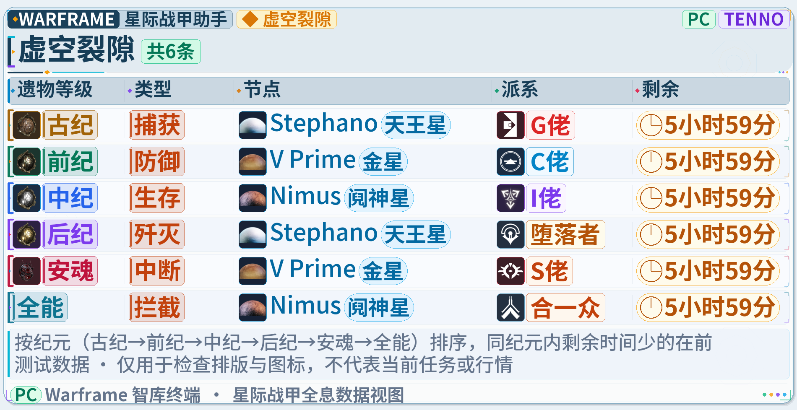
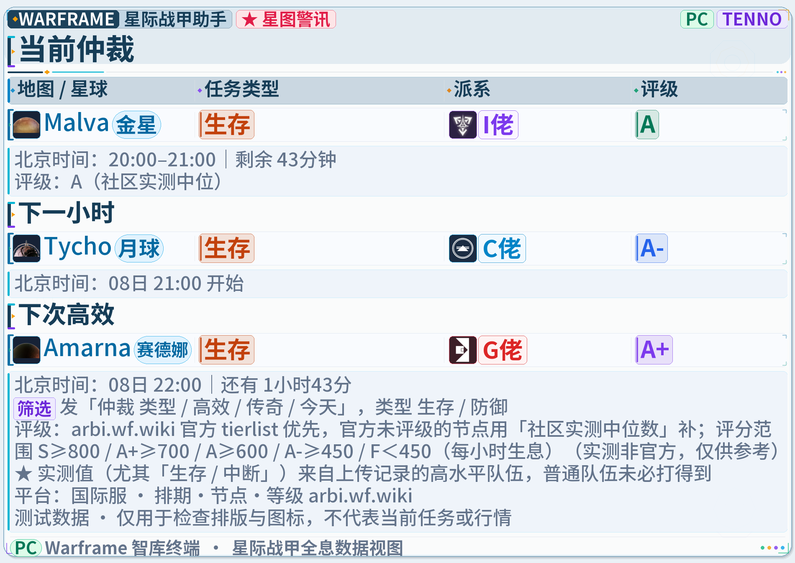
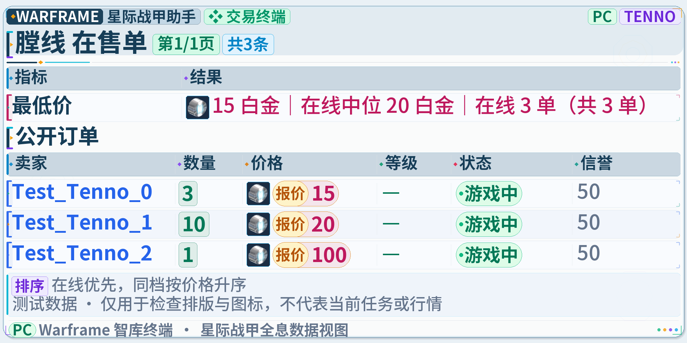
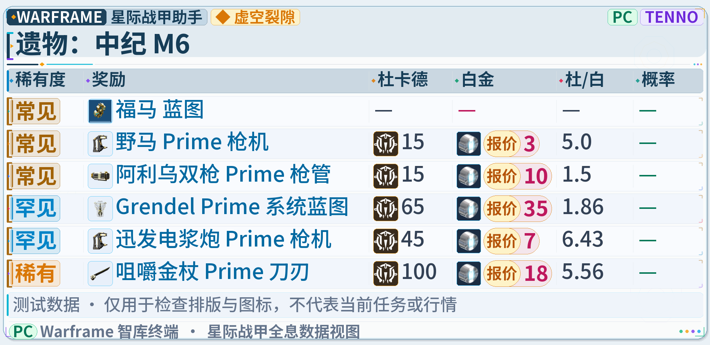
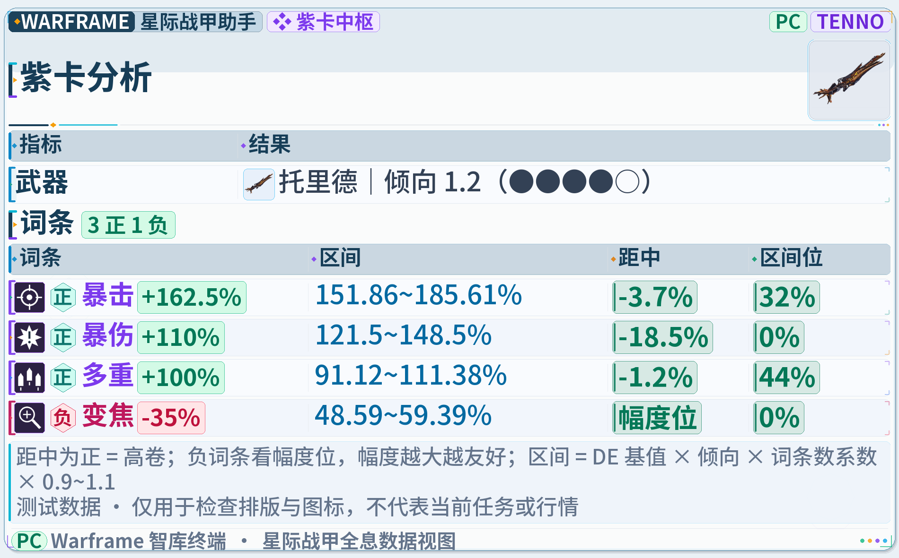
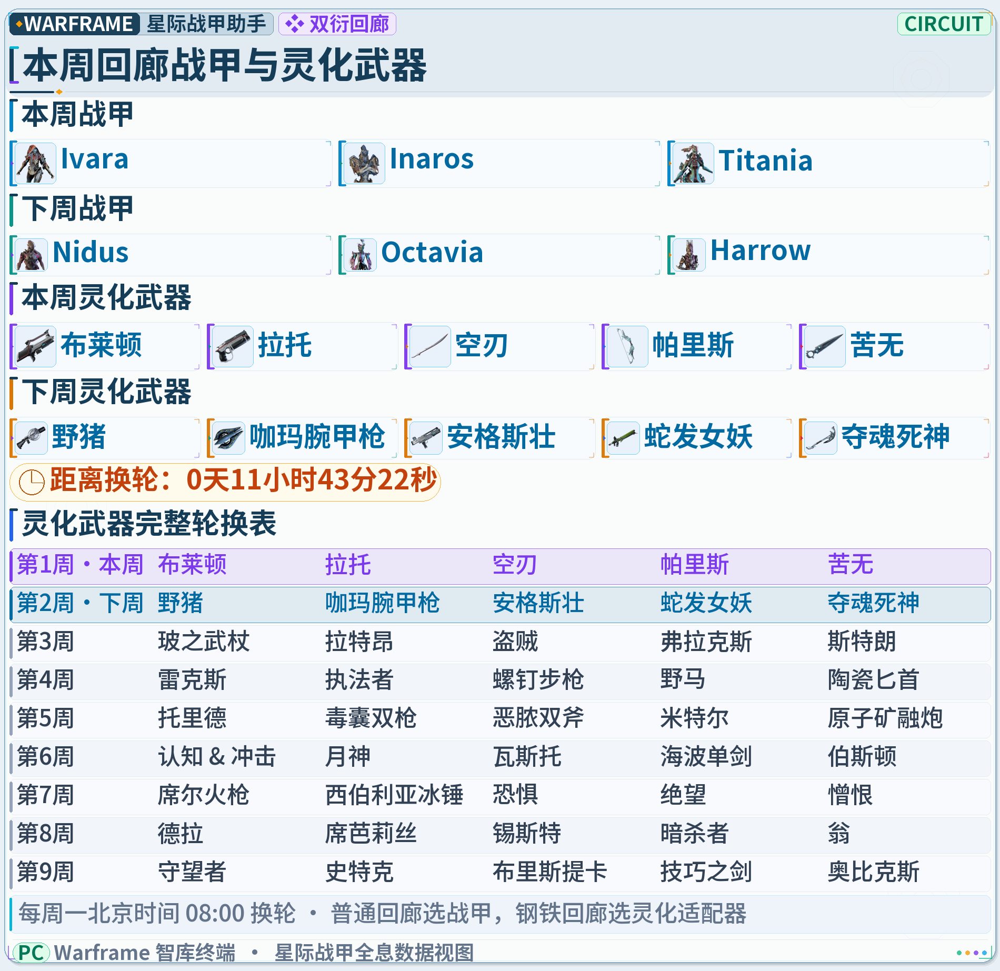

# AstrBot Warframe 助手

> **二次开发声明**：本项目基于 [skyti1437/Warframe-SDJK-Bot](https://github.com/skyti1437/Warframe-SDJK-Bot) 修改与整合，原作者为 **skyti1437（Sky）**。当前集成基线为上游 v1.2.9，提交 `4fed72a68e80aa075b592367f5b7c3efcd9bdf4c`，并非上游最新版本的完整同步。本项目保留上游署名及 GPL-3.0 许可证；由 Amy 维护独立的图片样式、主题配置、图标缓存、市场检索和本地适配。与上游项目及 Digital Extremes 无官方隶属或背书关系。详细修改记录见 [UPSTREAM.json](UPSTREAM.json) 与 [NOTICE.txt](NOTICE.txt)。

完整原生整合版：SDJK v1.2.9 的 57 个主功能已进入本插件的业务模块，共用一个 AstrBot 入口、指令注册表、图片输出与配置系统。没有嵌套插件，没有 `sdjk` 转发命令。来源及指令清单见 [功能移植说明](MIGRATION.md)。

## 功能截图

以下截图使用测试数据，仅展示图片布局与图标效果，不代表当前任务、市场价格或实际紫卡数值。点击图片可查看原图；背景、字体大小和颜色支持自定义。

| 世界状态 · 普通裂缝 | 仲裁 · 节点、派系与评级 |
| --- | --- |
| [](assets/readme/fissures.png) | [](assets/readme/arbitration.png) |
| **WM 市场 · 卖家、数量与白金报价** | **遗物 · 奖励图标与价格** |
| [](assets/readme/market.png) | [](assets/readme/relic.png) |
| **紫卡分析 · 词条与数值区间** | **回廊灵化 · 本周、下周与轮换表** |
| [](assets/readme/riven-analysis.png) | [](assets/readme/incarnon.png) |

## 安装或升级

1. 可从 AstrBot 的 GitHub 仓库安装入口安装本项目，或使用 `dist/` 中的插件 ZIP 安装包。解压后的 `astrbot_plugin_warframe` 放入 AstrBot 的 `data/plugins/`；`main.py` 必须直接位于插件目录中。
2. 升级时替换整个插件源码目录，避免残留旧模块。个人数据保存在 `data/plugin_data/astrbot_plugin_warframe/`，不要删除该数据目录。
3. 在 AstrBot 所用 Python 环境安装根目录 `requirements.txt` 并重载插件。依赖允许 Pillow 13，不要求降级 AstrBot Core。
4. 发送 `帮助` 或 `wf 帮助`；再测试 `wm 猴子`、`裂缝`、`遗物 古纪A1`。默认国际服 PC，支持 `-ps/-xb/-sw`。

指令一览（`帮助` / `wf 帮助`）完整显示在一张长图中，不分页。

## 直接使用

```text
wm 猴子
wm 女枪系统
wm 膛线 -rank=10 -r
wm 膛线 收购
wm 合购 膛线*2,生命力
wmr 托里德 暴击率 多重 -变焦
wmr 托里德 双暴 3+1 -all
遗物 古纪A1
部件 绝路
奸商 预测
伤害 绝路
紫卡分析 托里德 暴击率=162.5 伤害=172 多重=110.3 变焦=-35
识卡
识卡伤害
紫卡融合
词条范围 执法者
趋势 膛线
排行
xh 布拉玛
蹲 帮助
```

`wm` 查询战甲、武器、普通 MOD 和其他可交易物品。武器或战甲不写部件时按可交易整套匹配，指定系统、机体、枪管等时查单件；保留猴子、女枪、奶妈等俗称及 `measprime`、`ahsprim` 明确错拼。`wmr` 查询紫卡，`wr` 是同功能别名，单词条和多词条均可筛选；多词条默认全部匹配，只有明确追加 `近似` 才允许放宽。查询只读，不替用户购买或出价。

## 国服兼容（WeGame）

临时查询：`裂缝 -cn`、`钢铁裂缝 -cn`、`突击 -cn`、`平原 -cn`、`赏金 -cn`、`警报 -cn`、`入侵 -cn`、`奸商 -cn`。日常指令无需前缀：直接发送 `裂缝`、`突击`、`wm 猴子`。群管理员发送 `切换国服` 或 `切换国际服` 即可切换当前群；也兼容 `默认平台 国服` / `默认平台 pc`。插件全局默认平台也可配置为 `cn`。

数据来自 [WeGame 世界状态页面](https://www.wegame.com.cn/act/xjzj/xjzj20220330/index.html)，国服与国际服缓存隔离；图片标明国服，接口失败或数据过期会报错，不使用国际服实时数据补齐。现支持 15 类查询：裂缝、突击、执刑官、平原周期、赏金、警报、入侵、午夜电波、奸商、每日特惠、限时活动、商城礼包、虚空风暴、舰队建设、武形秘仪。已有本地地图与图标表用于补充显示；部分国服专用译名或奖励图标可能仍未匹配。

国服交易、仲裁预测、灵化等确定性轮换、紫卡分析、资料计算和订阅推送尚未验证，暂不开放。`wm/wmr` 不查询国服报价；在国服群显式加 `-pc` 可查询国际服。配卡/OCR 国际服功能不受影响。国服源未提供的周期不会显示。

## 紫卡识别与数值评分

紫卡截图仅使用本地 RapidOCR，已移除大模型与独立 OCR API 的调用入口和配置项，旧配置不再生效。未安装时按下方一键安装说明操作；仍支持手动输入词条分析。配卡「识卡」的视觉渠道不受影响。

数值评分按当前武器、倾向、正负词条数对应的理论区间计算：正面词条越接近上限分越高；负面词条按惩罚幅度反向评分，幅度越小分越高。综合分为各已确认词条等权平均。未揭示、缺少基值、超出区间或有待核对项时不出综合分。

| 分数 | 等级 | 默认颜色 |
| --- | --- | --- |
| 90–100 | S | 金色 |
| 75–不足90 | A | 绿色 |
| 50–不足75 | B | 蓝色 |
| 25–不足50 | C | 橙色 |
| 0–不足25 | D | 红色 |

这只是数值品质评分，不判断词条组合、特定配装对负属性的偏好，也不是市场估价。区间位仍表示数值幅度位置，因此负词条的区间位与评分方向相反。支持 `wf 配色 紫卡S #B45309` 等个人配色设置（A/B/C/D 同理）。

## 图片与个人设置

所有聊天结果使用我们自己的图片风格。市场卖家、数量、价格分别配色；裂缝遗物等级、任务类型、节点与派系分别配色，配遗物/派系图标；有白金金额时显示白金图标。遗物奖励、紫卡正负词条、区间、伤害指标和趋势使用相应布局。

```text
wf 配色 用户名 #2563EB
wf 配色 数量 #047857
wf 配色 价格 #BE185D
wf 配色 古纪 #A16207
wf 配色 地图 #0369A1
wf 配色 派系 #64748B
wf 配色 伤害数值 #C2410C
wf 字号 28
wf 字号 标题 42
wf 背景 #EAF1F6
wf 背景 图片名.png
wf 前缀 无 / .
wf 主题 重置
```

个人设置只影响自己。背景图片从管理员设置的背景目录选择；管理页面可导入字体、背景与标志。默认支持裸指令、`/`、`.`，也支持设置个人标点前缀；`wf` 与 `/wf` 是始终可用的设置恢复入口。

## OCR

`紫卡分析 + 截图` 使用紫卡识别，`识卡 + 配装截图` 识别 MOD 与等级，`识卡伤害` 使用识别结果计算伤害。识别后结合本地 MOD/武器资料、容量、极性、等级亮点与面板数值校验。未确认或矛盾字段会提示核对，不会把模型猜测当成游戏数据。

配卡「识卡」仍在插件配置 `game.vision_provider_id_scan` 指定支持图片的提供商；紫卡截图仅使用本地 OCR。

可选本地紫卡 OCR 使用 RapidOCR + ONNX Runtime，通过独立进程运行；在管理页部署、检测并启用。不会随插件安装自动下载权重。自动安装器面向 Linux x86_64 / CPython 3.12，其他环境需要准备独立解释器和模型。本地模式失败不自动改用云端。

### 新用户：一键安装本地 OCR

插件安装完成后**不会自动下载 RapidOCR 或模型**。如需无需大模型的截图分析，由 **AstrBot 管理员**（不是普通群管理员）在聊天中发送：

```text
一键安装本地OCR
本地OCR状态
```

第一条命令在后台下载校验依赖和模型，创建独立 Python 环境，检查成功后自动启用；第二条查看进度、失败原因或完成状态。重复发送安装命令不会并行重复安装。安装期间不要重启插件。命令不要求 `/` 或 `.` 前缀（如设置了个人前缀则遵循个人设置）。

- 自动部署支持 **Linux x86_64、CPython 3.12**，以 AstrBot 实际运行环境为准。
- 使用 CPU，无需显卡；建议 4 核、整机 8GB 内存，留出约 2GB 可用内存及至少 2GB 磁盘余量用于安装。
- 依赖和模型保存在插件持久化数据目录的 `game/riven-ocr/`，配置在 `game/riven_ocr.json`，更新插件保留；不安装到 AstrBot 核心 Python 环境。
- 旧的大模型与独立 OCR API 配置不再用于紫卡。未支持的系统请在管理页面手动指定兼容的独立解释器和模型。
- 当前本地 OCR 按单任务独立进程执行，忙时提示稍后重试；识别失败不会自动调用大模型或 API。

状态显示“已启用”后，在**同一条消息中**发送 `紫卡分析` 并附单张清晰紫卡截图。输出使用完整属性名称，如“暴击几率”“弱点伤害”“多重射击”；输入仍支持“暴击”“弱点伤”“多重”等简称。没有截图也可使用文字分析：

```text
紫卡分析 托里德 暴击162.5 病毒110.3 基伤172 负多重75.5
```

如果不安装本地 OCR，可手动输入武器与词条进行分析。任何识别方式都有可能读错；不确定或冲突的字段会要求核对。服务器实测的一张托里德截图本地识别约 7.4 秒，这不是所有图片的速度保证。

## 订阅和管理

管理员先使用 `开启 推送`，用户再通过 `蹲 帮助` 查看订阅类型、筛选和时间写法。`蹲 取消` 取消自己的订阅；管理员可管理群订阅。`关闭 推送` 暂停并保留订阅；`状态`、`默认平台` 等继续检查管理员权限。管理页面保留数据刷新、价格排行、OCR、主题、字体与订阅维护能力。

## 验证与外部条件

本插件离线单元测试、57 路由集成冒烟，以及移入本项目的 OCR/解析/伤害/订阅选择性测试均通过。完整记录见 MIGRATION.md。运行时仍需要数据源网络可达；实际聊天平台发送和真实 OCR 模型推理需在部署环境验收。

本项目基于 GPL-3.0 的 SDJK 源码集成，保留授权与来源；游戏素材和字体遵循各自许可。参见 LICENSE、NOTICE.txt、UPSTREAM.json。

### 本地武器图片

内置 670 条武器及形态记录、650 张去重后的武器图片，覆盖当前武器数据集的主武器、次要武器、近战、Arch-Gun、Arch-Melee、守护武器。文件位于 `assets/weapons/`，随插件安装，无需首次查询时下载，不受临时物品缓存的 256 张上限或 30 天过期规则影响。

武器查询主图及列表行图按中文名、英文名、内部路径精确匹配。普通版、Prime、赤毒、信条等版本分开；配件保留原有 WM 配件图，不以整枪替代。新武器不在当前素材库时，不会冒用相近武器图片。

更新素材可在插件目录执行 `python scripts/cache_weapon_art.py`（需要 aiohttp 和 Pillow，输出完整缓存清单）；也可在命令末尾指定 WFCD 提交 SHA 以复现。来源、版本及单张图片 URL 见 `assets/weapons/manifest.json`，游戏素材版权归 Digital Extremes。

### 战甲及模块化装备图片

内置 `assets/equipment/` 离线素材库，851 条装备/部件/蓝图记录、262 张去重图片，沿用背景、字号及文字颜色设置。具体记录数（包含本体、版本、部件和蓝图，不是独立装备数量）：

| 类别 | 记录数 |
| --- | ---: |
| 战甲 | 588 |
| Archwing | 25 |
| Zaw 自制近战 | 82 |
| Kitgun 自制枪械 | 56 |
| 增幅器 | 47 |
| K-Drive 滑板 | 41 |
| 殁世机甲 | 12 |

装备列表显示行图；名称明确的单件查询/WM 市场卡显示本地主图。普通版、Prime、本体、部件按完整名称区分。自制装备按部件展示，不合成任意组装搭配的整件图片；蓝图与部分部件采用数据源提供的通用素材。

更新命令：`python scripts/cache_equipment_art.py`，可追加提交 SHA。清单记录来源、缓存结果和缺失项；主体来源为 WFCD，微尘增幅器整件图补自 Warframe Wiki，逐项 URL 见 `assets/equipment/manifest.json`。安装包已含全部素材，无需用户首次查询时联网下载。

### 灵化详情图

「灵化」输出为一张完整图片：本周战甲三列、本周灵化武器两列、下周战甲与武器、剩余时间、完整武器轮换表。本周和下周用颜色与文字标记，不展示评价、推荐标签或武器版本列表。沿用自定义背景、字体、字号、物品名称及标题颜色。

普通回廊战甲按独立的 11 周表计算（`core/data/circuit_frames.json`，来源及锚点包含在文件中）；钢铁回廊沿用运行期 `rotations.json` 的武器轮换数据，不能将两者混用同一周次。换轮按周一 UTC 00:00（北京时间 08:00）。

### 裂缝查询默认范围

「裂缝」「裂隙」及未指定类型的筛选（例如「裂缝 生存」）仅查询普通任务，排除钢铁与九重天。「钢铁裂缝」「九重天裂缝」查询各自类型，「裂缝 全部」显式查询所有类型。查询直接返回完整任务列表图片，不再把概览单独拆成第一张图。订阅筛选规则不变。

### 仲裁地图与派系

当前仲裁、下一小时、下次高效分别按地图/星球、任务类型、派系图标和评级展示，合并为单张图片；保留时段、倒计时、实测效率及评级来源说明。仲裁时间表保留空单元格，避免字段缺失时列错位。

仲裁评级配色：S 金色、A+ 紫色、A 绿色、A- 蓝色、F 红色，未评级灰色。当前仲裁和时间表统一使用；按显示评级配色，不根据实测收益重新定级。可用 `wf 配色 仲裁S #B45309`、`wf 配色 仲裁A+ #7C3AED` 等分别自定义，也可在管理面板设置全局默认颜色。

警报改用任务信息与独立奖励明细，物品与星币分行、数量独立，补齐福马与月华脯离线图标。奖励组合不再整格误用星币图标。新增 32 种非元素紫卡词条自绘语义图标（含多重、暴击率、暴伤、射速、装填、弹药、连击等），沿用现有词条别名；这些图标不是 DE 官方素材，可用 `python scripts/draw_stat_icons.py` 重建。元素与派系继续使用原有素材。

离线补充 26 张共用部件素材，覆盖 40 种普通/Prime 部件类型。已知整件武器/战甲蓝图使用自身缩略图并加蓝图标识；部件蓝图使用部件图标。遗物、市场和其他物品表共享匹配，未知整件蓝图不猜图片。白金金额用图标加数字显示，整数不再带 .0；超过默认字号时表格图片适当加宽，避免表头和数字被挤断。运行 `python scripts/cache_component_art.py` 可重建部件缓存。

修复 `<ARCHWING>` 导出标签导致陨蜓 Prime 蓝图缺图，展示与图标匹配统一清除已知前缀。中文空战部件蓝图优先匹配已缓存的真实部件图，避免系统蓝图误用战甲系统通用图。

修复“负面：/正面：”中文冒号、ASCII 冒号及中点前缀导致元素和紫卡词条图标漏配。新增 `scripts/build_task_gallery.py` 离线任务图片测试包，含任务、市场、紫卡、伤害计算及图标矩阵，附本地浏览页、原图和对应指令清单。测试包位于 dist，不包含实时行情。

平原周期六个地区名称新增离线图标（夜灵平野、奥布山谷、魔胎之境、地球、双衍王境、扎利曼），最先换轮摘要同步显示；中文/英文名称均支持，用户名和敌人派系保持独立匹配。


补全突击奖励池图标，包括 Anasa 塑像、裂罅 Mod、三类加成、特殊功能槽连接器、反应堆／催化剂蓝图及传说核心；素材离线内置，保留奖励数量与概率。


赏金总览轮换与各地区详情奖励改为独立图标条目，覆盖当前赏金池 313 种奖励（387 个含数量条目），新增 211 张离线素材；包括隔离库、抢劫及深矿。加密的日记碎片使用自绘文档类别图标，其余匹配资源、MOD、赋能、遗物和装备／部件素材。保留原始奖励池与数量，不将缺省数量推断为 1。


轮换、活动及兑换奖励统一图标匹配，覆盖钢铁商店、裂罅碎块、言录使、奸商、阿耶、日历与活动奖励；补齐兑换货币图标。物品优先使用专属素材，未收录外观／场景／浮印／装饰／礼包／音乐使用自绘类别图标，未知物品使用通用物品图标，不冒用其他物品图片。商店列宽优化，奸商每行一件；活动奖励不再截取前 8 项。


星球／地图／节点字段统一显示星球图标，支持中英文、节点编号及节点名称，并覆盖九重天比邻星域、扎利曼、赤毒要塞、虚空等特殊星域；霍瓦尼亚按所在地显示地球。新增 20 张离线星图素材。节点归属来自内置星图表，同名歧义节点不猜测；不影响用户名、奖励与派系图标。


任务图采用高对比度 HUD 样式，普通卡片宽 1900px，紫卡分析卡片宽 2400px，大幅提升字号与胶囊标签字重，支持手机聊天界面免点开直接阅读；警报卡片重构为“上半区任务信息 + 下半区专属奖励胶囊”一体化圆角容器，优化裂缝、突击、执刑官、虚空风暴、仲裁时间表等列宽比例，减少短标签异常折行。


## 市场安装包与完整源码

GitHub 源码保留完整 PNG 素材、测试和构建脚本；市场归档通过 `.gitattributes` 排除预览、开发工具与重复的大图，使用同源 128px WebP 离线图标以及随包的 Noto Sans CJK 常用字子集。无需首次联网下载图片。完整字库可在外观设置中选择自定义字体。执行 `python scripts/build_market_assets.py` 可重新生成压缩素材；各素材原始来源仍记录在对应 manifest / sources 文件中。

### 洗卡推荐与同词条挂单

`托里德 洗卡推荐` 接入 WFSim 官方 MCP，展示标准单体场景下每个模式的前 3 个已模拟紫卡组合，包括完整正负词条、配装整体提升、配套 MOD 和模拟记录时间。`托里德 洗卡推荐 群怪` 查询标准群体场景；末尾加 `刷新` 重新获取。只在同场景、同模式内比较；组合排名不转换成单词条 S/A/B，也不将整套配装提升当作单词条贡献。结果仅覆盖 WFSim 已提交并计算的组合，不代表全部可能组合或实战通用最优解。暂无结果时明确提示，不回退到 WM 价差推荐。

插件配置 `wfsim_api_key` 可填 WFSim 密钥，留空也能查询。插件串行发起请求并控制间隔；缓存 1 小时，接口失败使用历史缓存并标明非实时与北京时间获取时间。旧查询别名仍通过现有武器资料解析，Prime 等变体按 WFSim 独立武器匹配。国服查询也使用 WFSim 国际服模拟资料作参考。

数据来源：[WFSim](https://wfsim.app/) 的公开 MCP 查询，使用外部服务，不复制其模拟引擎。计算条件见[场景说明](https://wfsim.app/method)。

`紫卡分析` 下方展示与所分析紫卡正负词条集合完全相同的 WM 挂单：同武器家族，按有效一口价从低到高取前 5 张，含离线卖家。展示卖家状态、MOD 等级、每条原始数值及 S/A/B/C/D 数值评分。数值评分使用对应等级的理论区间，缺失等级、未知属性或越界数值显示待核对，不强行评级。

“同词条”不要求具体数值、洗数相同；价格是卖家挂牌价而非成交价。WM 查询失败不会阻断紫卡本身的数值分析，没有匹配时明确提示。
